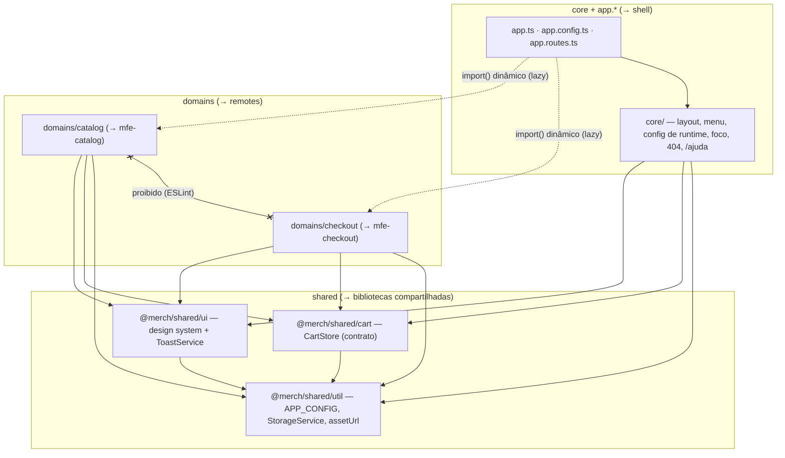

# Arquitetura — fase 1 (monólito componentizado)

Princípio: **toda decisão da fase 1 barateia as fases 2 e 3.** O monólito já tem as fronteiras que
viram fronteiras de deploy: o código de cada domínio só se conhece por URL ou pelo contrato do carrinho,
e isso é verificado pelo ESLint (código) e por `npm run check:bundles` (bundle).

## Áreas e dependências permitidas



| De ↓ / Para → | core | catalog | checkout | shared/* |
|---|---|---|---|---|
| `app.*` + `core` | ✔ | só `import()` em `app.routes.ts` | só `import()` em `app.routes.ts` | ✔ |
| `domains/catalog` | ✘ | (relativo, interno) | ✘ | ✔ |
| `domains/checkout` | ✘ | ✘ | (relativo, interno) | ✔ |
| `shared/*` | ✘ | ✘ | ✘ | ✔ (entre si, por alias) |

Regras aplicadas por `no-restricted-imports` em `projects/monolith/eslint.config.js`: sem import profundo
(`@merch/shared/ui/button/...`), sem caminho relativo atravessando áreas, e o bloco de cada área sempre
**recompõe** a lista inteira (no flat config o bloco mais específico substitui a regra).

## Rotas → domínio

| URL | Página | Domínio | Notas |
|---|---|---|---|
| `/` | `HomePage` | catalog | hero, Populares, sazonal, coleções, sustentabilidade (`@defer`) |
| `/c/:categorySlug` | `CategoryPage` | catalog | `?subcategoria=&colecao=&preco=&promocao=1&ordem=`; virtuais: `novidades`, `promocoes`, `todos` |
| `/busca?q=` | `SearchPage` | catalog | contrato por URL com a busca do shell |
| `/p/:productSlug` | `ProductPage` | catalog | `title` por resolver; inexistente → "Produto não encontrado" |
| `/checkout` | redirect → `carrinho` | checkout | |
| `/checkout/carrinho` | `CartPage` | checkout | |
| `/checkout/entrega` | `ShippingStep` | checkout | guard: carrinho não vazio |
| `/checkout/pagamento` | `PaymentStep` | checkout | guard: + entrega válida |
| `/checkout/revisao` | `ReviewStep` | checkout | guard: + pagamento escolhido |
| `/checkout/confirmacao/:orderId` | `ConfirmationPage` | checkout | guard: pedido existe na sessão |
| `/ajuda/:topico` | `InfoPage` | core | conteúdo institucional do shell |
| `**` | `NotFound` | core | |

Ordem em `app.routes.ts`: `checkout` → `ajuda` → `''` (catalog) → `**`. Cada domínio tem uma rota pai
`path: ''` com seus `providers` (catalog: `ProductApi`, `ASSETS_BASE_URL`, `IMAGE_LOADER`; checkout:
`CheckoutStore`, `OrderService`) — o domínio leva o próprio escopo de DI quando virar remote.

## Contrato do `CartStore` (`@merch/shared/cart`)

Único estado global. Escrito pelo catálogo, lido pelo shell (contador) e pelo checkout.

```ts
interface CartItem {            // snapshot autossuficiente
  readonly sku: string;
  readonly productId: string;
  readonly slug: string;
  readonly name: string;
  readonly imageUrl: string;    // ABSOLUTA (assetUrl do domínio de origem)
  readonly unitPriceInCents: number;
  readonly variantLabel?: string;
  readonly maxQuantity: number;
  readonly quantity: number;
}

class CartStore {
  // leitura
  items: Signal<readonly CartItem[]>;
  count: Signal<number>;              // soma das quantidades
  subtotalInCents: Signal<number>;
  // escrita
  add(item: Omit<CartItem, 'quantity'>, quantity?: number): void; // mesma sku soma, até maxQuantity
  updateQuantity(sku: string, quantity: number): void;            // 0 remove
  remove(sku: string): void;
  clear(): void;
}
```

- Persistência em `localStorage` na chave versionada **`merch.cart.v1`** (via `StorageService`); itens
  inválidos são descartados um a um; sincroniza entre abas pelo evento `storage`.
- Mudar o contrato é breaking change. Na fase 2 ele é o principal ponto de integração entre micro frontends.

Outros contratos **por URL** (não por código): busca → `/busca?q=`; carrinho → `/checkout/carrinho`;
produto → `/p/:slug`; categoria/coleção → `/c/...?subcategoria=|colecao=`.

## Mapa de extração (fase 2)

| Hoje (monólito) | Fase 2 | O que muda |
|---|---|---|
| `app.*` + `core/` | projeto **`shell`** (host) | `loadChildren: () => import('@merch/catalog')` vira `loadRemoteModule('mfe-catalog', './routes')`; `config.json` dá lugar/convive com `federation.manifest.json` |
| `domains/catalog` | remote **`mfe-catalog`** | `index.ts` (só `CATALOG_ROUTES`) vira o `exposes`; `ASSETS_BASE_URL` passa a ser a origem do remote |
| `domains/checkout` | remote **`mfe-checkout`** | `index.ts` (só `CHECKOUT_ROUTES`) vira o `exposes` |
| `shared/ui`, `shared/cart`, `shared/util` | bibliotecas do workspace (`ng g library`) **com o mesmo alias** | imports não mudam; Native Federation compartilha como singleton |

## Acoplamentos que a fase 2 vai enfrentar — e como já foram mitigados

| Acoplamento | Risco na extração | Mitigação já feita na fase 1 |
|---|---|---|
| **Estado do carrinho** compartilhado | duas instâncias de `CartStore` (uma por bundle) → contador do header não atualiza | estado só em `shared/cart`, API mínima e snapshot autossuficiente; persistência + evento `storage` funcionam até entre instâncias; na fase 2: `shared/cart` como **singleton** no Native Federation |
| **Assets em outra origem** | imagens/JSON do catálogo com caminho fixo quebram quando o remote roda em outro host | todo asset passa por `assetUrl()` + `ASSETS_BASE_URL` fornecido **na rota do domínio**; `IMAGE_LOADER` do catálogo; `CartItem.imageUrl` sempre absoluta; checkout não tem asset (QR em SVG inline) |
| **Estilos globais** | remote trazendo CSS global e sobrescrevendo o shell | só `src/styles/` (reset + tokens) é global e fica no shell; componentes 100% encapsulados e baseados em `var(--…)`; breakpoints via mixins SCSS |
| **Locale em cada app** | remote formatando moeda em en-US | `LOCALE_ID`/`DEFAULT_CURRENCY_CODE` e `registerLocaleData(pt)` no `app.config` (comentado: cada remote precisa garantir); `Price` usa os tokens injetados |
| **Dependências compartilhadas** | versões divergentes entre shell e remotes; bundles duplicados | runtime só `@angular/*` (incl. `@angular/aria`, `@angular/cdk`), `rxjs`, `tslib`, todas com `~`; nenhuma lib de terceiros para compartilhar |
| **Config de runtime** | trocar remote/ambiente exigindo rebuild do shell | `config.json` lido por `provideAppInitializer` e gerado no start do container por env vars — o mesmo padrão do manifest da fase 2 |
| **DI de domínio em `root`** | services do domínio "vazando" para o shell | `ProductApi`, `CheckoutStore`, `OrderService` são `@Service({ autoProvided: false })` nos `providers` da rota do domínio |
| **Foco/navegação** | shell e remotes disputando foco | foco no `<main>` é responsabilidade do shell (`focusMainOnNavigation`) e só em troca de página (não em query params) |

## Provas automatizadas

- `npm run lint` — fronteiras de import.
- `npm run check:bundles` — nenhum arquivo de `domains/` no bundle inicial; `catalog` e `checkout` em
  chunks lazy distintos, sem chunk misturando domínios.
- `npm run e2e` — jornada completa + axe; é a **suíte de paridade**: na fase 2 e 3 roda igual, mudando só `BASE_URL`.
