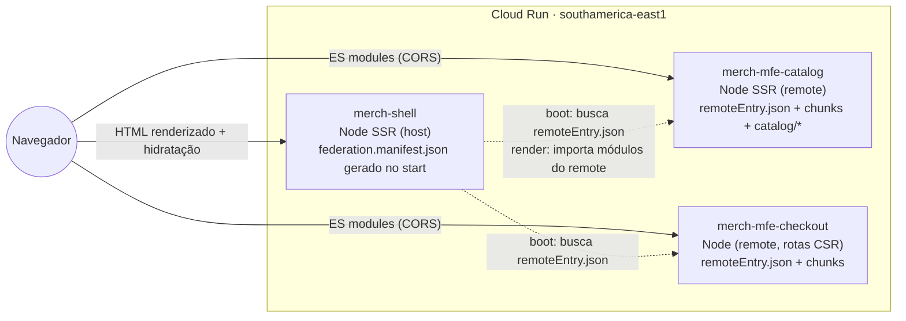
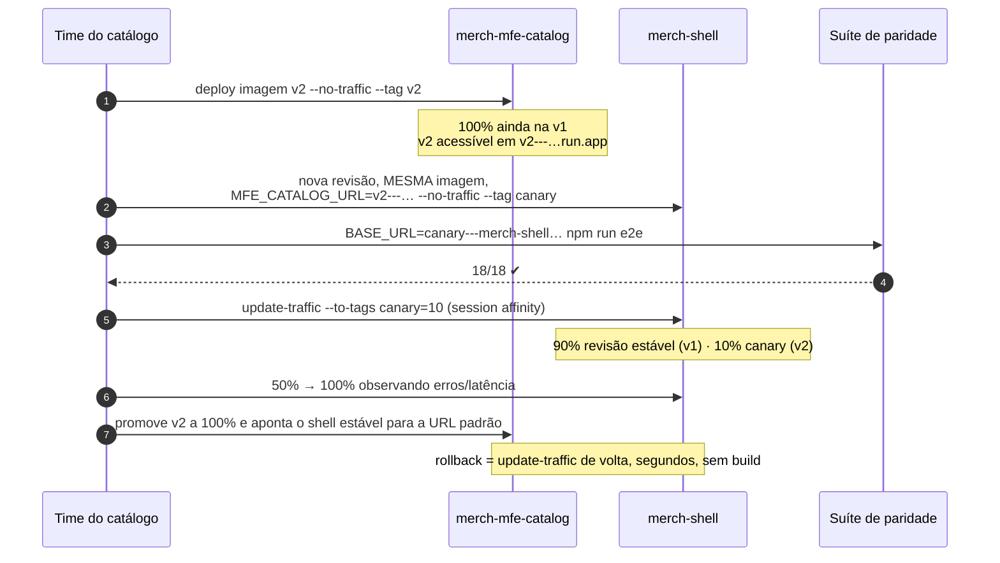

# Plano de migração — do monólito a Micro Frontends com SSR (Native Federation + Cloud Run)

> Workshop ao vivo: **"Do monólito ao Micro Frontends em produção: Native Federation + Cloud Run"**.
> Ponto de partida: tag `f1-final` (monólito componentizado, CSR, 181 testes unitários, 18 e2e, container nginx).
> Ponto de chegada: **shell SSR + `mfe-catalog` + `mfe-checkout`**, três serviços no Cloud Run, com **canário de um
> remote sem rebuild do shell**.

Fontes verificadas em 31/10/2026: `@angular-architects/native-federation` **22.2.4** (adapter v4, acompanha o
Angular 22.2) e a documentação v4 (getting started, runtime, configuration, SSR & Hydration, sharing,
orchestrator). Pontos que a documentação **não** confirma estão marcados com 🔬 e são validados no spike da
etapa 0, antes do ao vivo.

---

## 1. Resumo executivo

| | Fase 1 (hoje) | Fase 2 (federação + SSR) | Fase 3 (produção) |
|---|---|---|---|
| Projetos | `monolith` | `shell`, `mfe-catalog`, `mfe-checkout` + libs `shared/*` | os mesmos |
| Renderização | CSR | **SSR** no catálogo (SEO); **CSR** no checkout (estado pessoal) | igual |
| Integração | `import()` dinâmico | `loadRemoteModule` + `federation.manifest.json` em runtime | manifest gerado por env var no start |
| Deploy | 1 container nginx | local (3 servidores Node) | **3 serviços Cloud Run** + canário por tags de revisão |
| Prova de paridade | e2e (18 cenários) | a **mesma** suíte, sem alterações | a **mesma** suíte, `BASE_URL` público |

O trabalho difícil já foi feito na fase 1: fronteiras de import (ESLint), domínios autossuficientes (providers
na rota), assets via `ASSETS_BASE_URL`, carrinho como contrato, config de runtime, e2e por papel/rótulo. A
migração é, em grande parte, **mover pastas e trocar `import()` por `loadRemoteModule`**. O SSR é a parte nova
e a que mais cobra preço — por isso entra **depois** da federação estar verde.

---

## 2. Quando MFE vale a pena (e quando é over-engineering)

Abrimos o workshop com esta pergunta, sem rodeio: **para a Merch Store real, MFE seria over-engineering.** Ela
é pequena, tem um time e uma cadência. Usamos o caso porque é pequeno o bastante para caber em uma sessão e
grande o bastante para mostrar todos os problemas.

| Sinais de que **vale** | Sinais de **over-engineering** |
|---|---|
| ≥ 3 times com donos claros de domínios diferentes | 1–2 times mexendo em tudo |
| Cadências de release diferentes (catálogo diário, checkout semanal com aprovação) | Todo mundo publica junto mesmo |
| O deploy do monólito virou gargalo (fila, rollback de tudo por causa de um) | Build e deploy já são rápidos |
| Domínios com requisitos não funcionais distintos (SEO vs. conformidade/PCI) | Requisitos homogêneos |
| Necessidade de migrar stack aos poucos (strangler) | Stack única e atual |
| Organização disposta a pagar plataforma: contratos, observabilidade, CI por time | "Vamos dividir e ver o que acontece" |

**Alternativas mais baratas que resolvem 80% dos casos** (mostrar antes de federar): monólito modular com
fronteiras de lint (é a nossa fase 1), deploy único com feature flags, monorepo com builds afetados (Nx/cache),
lazy loading por domínio. A fase 1 já entrega "fronteiras de bundle" sem nenhum custo de runtime — esse é o
contraponto que a plateia deve levar.

**O que MFE custa** (retomado no checklist): latência e bytes extras por remote, 3× a infraestrutura (e 3× cold
start), negociação de versões, contratos entre times, depuração distribuída, e — com SSR — acoplamento de
**ordem de boot** e risco de **hydration mismatch**.

---

## 3. Arquitetura alvo



### Mapa de extração (da fase 1)

| Fase 1 | Fase 2 | Observação |
|---|---|---|
| `projects/monolith` (`app.*` + `core/`) | `projects/shell` (host, `--type dynamic-host`, porta 4200) | renomear/gerar e mover `core/`; estilos globais e locale ficam aqui |
| `domains/catalog` | `projects/mfe-catalog` (remote, porta 4201) | `exposes: { './routes': .../index.ts }` — o `index.ts` já exporta só `CATALOG_ROUTES` |
| `domains/checkout` | `projects/mfe-checkout` (remote, porta 4202) | `exposes: { './routes': .../index.ts }` |
| `shared/ui`, `shared/cart`, `shared/util` | bibliotecas do workspace (`ng g library`), **mesmo alias** `@merch/shared/*` | `paths` apontam para o **fonte** da lib (não para `dist`), para o `sharedMappings` do Native Federation |
| `public/catalog/` | `projects/mfe-catalog/public/catalog/` | servido pelo remote, resolvido por `ASSETS_BASE_URL` |
| `config.json` | `config.json` + `federation.manifest.json` | ambos gerados no start do container a partir de env vars |

### Rotas e modo de renderização

| Rotas | Dono | `RenderMode` | Por quê |
|---|---|---|---|
| `/`, `/c/**`, `/busca`, `/p/**` | mfe-catalog | `Server` | SEO e primeira pintura; dados públicos |
| `/checkout/**` | mfe-checkout | `Client` | estado pessoal (sessionStorage/localStorage), guards dependem dele; sem valor de SEO |
| `/ajuda/**` | shell | `Prerender` ou `Server` | conteúdo estático do shell |
| `**` | shell | `Server` (status 404) | |

> 🔬 **Risco nº 1 (validar no spike):** a doc v4 avisa que um `loadChildren` federado **não entra no manifest
> de rotas do build**, e requisições diretas (deep link, F5) a rotas dele podem responder 404 no SSR. A doc
> recomenda filhos com `loadComponent` + `.catch(() => RemoteUnavailable)`. Plano A: manter `loadChildren`
> (`./routes`) e declarar no `app.routes.server.ts` os prefixos (`c/**`, `p/**`, `busca`, `checkout/**`) com o
> render mode desejado — **confirmar no spike**. Plano B (se A falhar): o shell declara os prefixos de rota e cada
> página vira um `exposes` (`./HomePage`, `./CategoryPage`…) carregado com `loadComponent`. B acopla o shell aos
> caminhos do remote — custo a explicar no palco.

---

## 4. Estratégia de dependências compartilhadas

Regra de ouro: **o que é estado ou identidade é singleton; o que é framework anda em lockstep.**

```js
// federation.config.mjs (shell e remotes — mesmo bloco de shared)
import { withNativeFederation, fromPackageJson } from '@angular-architects/native-federation/config';

export default withNativeFederation({
  name: 'mfe-catalog', // 'shell' no host, 'mfe-checkout' no outro remote
  exposes: { './routes': './projects/mfe-catalog/src/app/index.ts' },
  shared: fromPackageJson({ singleton: true, strictVersion: true, requiredVersion: 'auto', build: 'package' })
    .patch(['@angular/*'], { includeSecondaries: { keepAll: true } })
    .get(),
  sharedMappings: ['@merch/shared/ui', '@merch/shared/cart', '@merch/shared/util'],
  skip: ['rxjs/ajax', 'rxjs/fetch', 'rxjs/testing', 'rxjs/webSocket'],
  features: { denseChunking: true, denseExternals: true },
});
```

| Pacote | Política | Motivo |
|---|---|---|
| `@angular/*` (core, common, router, forms, aria, cdk, platform-*) | singleton + `strictVersion` + lockstep `~22.2` | duas cópias do core = `NG0203` e DI quebrada |
| `rxjs`, `tslib` | singleton | 1 cópia, sem custo |
| `@merch/shared/cart` | **singleton obrigatório** | o contador do header (shell) e o "Adicionar" (catálogo) precisam da **mesma** instância do `CartStore` |
| `@merch/shared/ui` (inclui `ToastService`) | singleton | toast publicado pelo catálogo e renderizado pelo `ToastHost` do shell |
| `@merch/shared/util` (`APP_CONFIG`, `StorageService`, `ASSETS_BASE_URL`) | singleton | tokens de DI precisam ter a mesma identidade |
| Locales (`@angular/common/locales/pt`) | shell registra; avaliar `shareAngularLocales` | remotes não reregistram |

**Política de versões entre times** (para o palco):

1. **Angular em lockstep.** Atualização = PR único no monorepo, os três projetos sobem juntos (Renovate com grupo
   `angular`). Com `strictVersion: true`, divergência **quebra em runtime** — preferimos falhar alto em staging a
   ter duas cópias do framework em produção.
2. **Libs `@merch/shared/*` versionadas por contrato** (seção 7): mudança compatível = qualquer time publica;
   mudança breaking = nova versão do contrato + período de convivência.
3. **Nenhuma dependência nova de runtime sem aprovação** (regra que já existe no `AGENTS.md`): toda dependência vira
   dependência compartilhada.

**Novas dependências que este plano pede aprovação** (antes do ao vivo):

| Pacote | Tipo | Por quê |
|---|---|---|
| `@angular-architects/native-federation` 22.2.x | dev | builder + runtime da federação |
| `@softarc/native-federation-orchestrator` | dev (adicionado pelo schematic) | orquestrador de remotes (browser e Node) |
| `es-module-shims` | runtime (adicionado pelo schematic) | import maps dinâmicos no navegador |
| `@angular/ssr`, `@angular/platform-server` | runtime (`@angular/*`, já permitido) | SSR |
| `express` | runtime — **precisa aprovação** | servidor gerado pelo `ng add @angular/ssr` |
| `cors` | runtime — **precisa aprovação** | o schematic de SSR do NF adiciona `app.use(cors())`; remotes servem módulos para outra origem |

---

## 5. Mudanças no código da fase 1 exigidas pelo SSR

O SSR muda a pergunta "funciona?" para "funciona **igual** no servidor e no navegador?". Lista do que a fase 1 já
resolve e do que precisa mudar:

| Ponto | Situação na fase 1 | Ação na fase 2 |
|---|---|---|
| `window`/`localStorage` | só via `StorageService` (usa `DOCUMENT.defaultView`, fallback em memória) | ✅ já seguro no servidor |
| **Contador do carrinho** | lido do `localStorage` no construtor | ⚠️ servidor renderiza "vazio", navegador "2 itens" → **hydration mismatch**. `CartStore` ganha `ready` (verdadeiro só após `afterNextRender`); o badge mostra a contagem só quando `ready()`. Mesma regra para a `PromoBar` (dispensada no storage) |
| Checkout (guards + `sessionStorage`) | guards leem o estado no navegador | ⚠️ no servidor o carrinho é vazio e o guard redirecionaria um F5 em `/checkout/entrega`. Resolver com **`RenderMode.Client`** em `/checkout/**` |
| `config.json` via `HttpClient` relativo | `provideAppInitializer` busca `config.json` | ⚠️ no servidor URL relativa não resolve: `app.config.server.ts` fornece `APP_CONFIG` a partir de `process.env` e o navegador recebe via `TransferState` |
| `ProductApi` (`httpResource` com `assetUrl`) | URL absoluta resolvida contra `ASSETS_BASE_URL` | ✅ funciona no Node. Adicionar `provideClientHydration(withHttpTransferCacheOptions(...))` para o navegador **não** refazer as requisições; 🔬 confirmar transfer cache para origem cruzada (remote) |
| `ASSETS_BASE_URL` do catálogo | `''` (mesma origem) | origem do remote. Opção preferida: derivar do próprio módulo (`new URL('.', import.meta.url)`), que vale no navegador e no Node; alternativa: vir do manifest/config. 🔬 validar no spike |
| `@defer (on viewport)` na home | placeholders `Skeleton` | ✅ no servidor renderiza o placeholder; avaliar **hidratação incremental** (`@defer (on viewport; hydrate on viewport)`) para Populares/Coleções — SEO dos produtos populares |
| Foco no `<main>` e view transitions | `afterNextRender` | ✅ só roda no navegador |
| `NgOptimizedImage` + `priority` | ✅ | no SSR o `priority` vira `<link rel="preload">` no HTML — ganho real de LCP |
| Título por resolver | ✅ `ResolveFn` | ✅ título correto já no HTML do servidor (SEO) |

---

## 6. Deploy independente com release progressivo

### O canário ingênuo — e por que ele quebra com SSR

"Dividir 10% do tráfego do serviço `merch-mfe-catalog` para a revisão nova" **não funciona** aqui:

1. **O servidor congela os remotes no boot.** O host SSR busca o `remoteEntry.json` uma única vez (doc v4). Cada
   instância do shell renderiza com a versão que viu ao subir — independente do split.
2. **Mistura de revisões nos chunks.** O navegador pode pegar o `remoteEntry.json` da revisão A e o `chunk-XYZ.js`
   da B → 404 (hash diferente).
3. **Hydration mismatch.** HTML gerado com a v1 no servidor, hidratado com a v2 no navegador.

### O canário que funciona: tags de revisão + manifest em runtime

Cada revisão do Cloud Run pode ter uma **URL própria por tag** (`https://v2---merch-mfe-catalog-<hash>.run.app`),
internamente consistente. O canário acontece **no shell**, trocando só o `federation.manifest.json` — gerado no
start do container por env var, como o `config.json` da fase 1. **Mesma imagem do shell, nenhum rebuild.**



Comandos (documentados; executados ao vivo **apenas** com projeto e orçamento confirmados):

```bash
# 1) remote v2 sem tráfego, com URL própria
gcloud run deploy merch-mfe-catalog --image "$IMG_CATALOG:v2" \
  --region southamerica-east1 --no-traffic --tag v2

# 2) shell canário: MESMA imagem (digest), só o manifest muda via env
gcloud run deploy merch-shell --image "$IMG_SHELL@$SHELL_DIGEST" \
  --region southamerica-east1 --no-traffic --tag canary \
  --update-env-vars MFE_CATALOG_URL=https://v2---merch-mfe-catalog-<hash>.run.app/remoteEntry.json

# 3) paridade contra a URL do canário
BASE_URL=https://canary---merch-shell-<hash>.run.app npm run e2e

# 4) release progressivo (afinidade de sessão: o mesmo usuário fica na mesma revisão)
gcloud run services update merch-shell --region southamerica-east1 --session-affinity
gcloud run services update-traffic merch-shell --region southamerica-east1 --to-tags canary=10
gcloud run services update-traffic merch-shell --region southamerica-east1 --to-tags canary=50
gcloud run services update-traffic merch-shell --region southamerica-east1 --to-tags canary=100

# 5) rollback instantâneo (a qualquer momento)
gcloud run services update-traffic merch-shell --region southamerica-east1 --to-revisions <rev-estavel>=100
```

**Mudança do canário ao vivo:** o `ProductCard` foi isolado em `ui/product-card` na fase 1 exatamente para isso.
Proposta: selo "Pix −5%" e preço em destaque — visível na home e na categoria, risco baixo, diff pequeno.

**Ordem de boot (custo do SSR):** como o shell busca os remotes no boot, os remotes sobem **antes**. No Cloud Run:
`min-instances=1` nos remotes e no shell, e a decisão de `NF_REQUIRE_REMOTES` da seção 7.

---

## 7. Checklist de produção

### Quando um remote cai

- [ ] Toda rota federada tem `.catch(() => RemoteUnavailable)` — componente do shell com mensagem, link para a home
      e status HTTP adequado no SSR (503). Nunca tela branca.
- [ ] `strict.strictRemoteEntry` **desligado** em produção (padrão do orquestrador: loga e segue) — um remote fora
      não derruba o shell no navegador.
- [ ] Decisão explícita de `NF_REQUIRE_REMOTES` no shell SSR:
      | Valor | Efeito | Quando |
      |---|---|---|
      | vazio | shell sobe mesmo sem remotes; regiões ficam vazias **até reiniciar** | site degradado aceitável |
      | `mfe-catalog` | instância nova falha se o catálogo estiver fora; revisões existentes seguem servindo | catálogo é a home: sem ele o site não serve |
      Recomendação para a loja: `mfe-catalog` obrigatório (deploy do shell falha seguro se o catálogo estiver
      fora); `mfe-checkout` opcional com fallback.
- [ ] Health check: expor o estado de `__NF_FEDERATION_STATUS__` num `/healthz` do shell (startup probe do Cloud Run)
      e alertar quando um remote não registrou.
- [ ] Teste e2e de resiliência: derruba o `mfe-checkout` e confere que home/produto funcionam e o checkout mostra o
      fallback.
- [ ] Timeouts no servidor para importar remotes (o render SSR não pode esperar indefinidamente).

### Versionamento de contratos entre times

| Contrato | Hoje | Regra |
|---|---|---|
| `exposes` (`./routes`) | 1 entrada por remote | adicionar é compatível; renomear/remover = **nova chave** (`./routes-v2`) com convivência |
| `CartItem` + chave de storage | `merch.cart.v1` | campo novo opcional = compatível; mudança de forma = `merch.cart.v2` + migração na leitura |
| Contratos por URL (`/busca?q=`, `/p/:slug`, `/checkout/carrinho`, `?subcategoria=`) | documentados em `docs/arquitetura-fase-1.md` | tratados como API pública: redirect ao mudar |
| `federation.manifest.json` | gerado por env | versão no nome da tag de revisão; nunca editar à mão em produção |

- [ ] **Teste de contrato dirigido pelo consumidor:** o pipeline de cada remote roda a suíte e2e de paridade contra
      um shell de staging apontando para a revisão candidata (é o passo 3 do canário).
- [ ] CHANGELOG por remote e política de depreciação (ex.: duas releases de convivência).
- [ ] `strictVersion` + lockstep do Angular verificados no CI (build falha se algum projeto divergir).

### Plataforma

- [ ] **CORS** nos remotes: `Access-Control-Allow-Origin` restrito às origens do shell (não `*`).
- [ ] **CSP** do shell: incluir as origens dos remotes em `script-src`/`connect-src` (manter a CSP estrita da fase 1).
- [ ] **Cache:** `remoteEntry.json`, manifest e HTML com `no-cache`; chunks com hash `immutable` (como na fase 1).
- [ ] `min-instances=1` no shell e nos remotes (cold start × 3); medir TTFB do SSR.
- [ ] Observabilidade: trace propagado do shell (SSR) para as buscas aos remotes; logs com nome do remote e revisão.
- [ ] Custos: três serviços sempre ligados — colocar o número na mesa.

### Onde a arquitetura cobra seu preço (fechamento do workshop)

| Preço | Como aparece | Como contemos |
|---|---|---|
| Acoplamento de boot (SSR) | remote fora no boot → região vazia até reiniciar | ordem de deploy, `NF_REQUIRE_REMOTES`, health check |
| Hydration mismatch | estado do navegador renderizado no servidor | `RenderMode.Client` no checkout, `ready` no carrinho |
| Latência | HTML depende de N remotes no servidor | `min-instances`, região única, cache de remoteEntry no boot |
| Versão do framework | `strictVersion` quebra em runtime | lockstep + CI |
| Depuração distribuída | erro "no shell" causado pelo remote | trace + revisão nos logs |
| Custo fixo | 3× serviços e pipelines | só vale com os sinais da seção 2 |

---

## 8. Roteiro do workshop (etapas, tags e checkpoints)

Mesmo formato da fase 1: uma etapa por vez, Definition of Done do `AGENTS.md` (lint, test, build, verificação,
commit e tag), **e2e de paridade verde em toda etapa**. As tags são **checkpoints de recuperação no palco**: se uma
etapa falhar ao vivo, `git checkout <tag>` e seguir.

### Etapa 0 — Preparação (antes do ao vivo)

- [ ] Aprovar as dependências da seção 4 e atualizar o `AGENTS.md` (§2 "Apenas CSR" → "SSR no catálogo, CSR no checkout").
- [ ] **Spike 🔬** no [playground do Native Federation](https://github.com/native-federation/playground) com Angular 22.2:
      (a) deep link SSR em rota de `loadChildren` federado (risco nº 1, seção 3); (b) `import.meta.url` para
      `ASSETS_BASE_URL`; (c) transfer cache de requisição a outra origem; (d) tempo de boot do shell com 2 remotes.
- [ ] Projeto GCP, Artifact Registry e orçamento confirmados; canário ensaiado de ponta a ponta.
- [ ] Opcional: publicar o monólito (`f1-final`) no Cloud Run como linha de base de latência.
- [ ] Ensaiar com rede ruim e com o Wi-Fi do evento; imagens já no Artifact Registry como plano B.

### Fase 2 — Federação (local)

| Etapa | Entrega | Tag | Duração ao vivo |
|---|---|---|---|
| E1 · Bibliotecas `shared/*` | `ng g library` ×3, mesmo alias, `paths` apontando para o fonte; lint de fronteira entre projetos | `f2-e1-libs` | 15 min (pré-gravada se preciso) |
| E2 · Projetos | `ng g application mfe-catalog` / `mfe-checkout`; mover `domains/*` e `public/catalog`; `monolith` → `shell` | `f2-e2-projetos` | 15 min |
| E3 · Native Federation (CSR) | `init --type remote` ×2 e `--type dynamic-host`; `exposes: './routes'`; shared da seção 4; `loadRemoteModule` em `app.routes.ts`; `RemoteUnavailable`; e2e verde nas portas 4200/4201/4202 | `f2-e3-federacao` | 25 min |
| E4 · SSR | `ng add @angular/ssr` (shell e remotes) → init do NF ajusta `server.ts`; `app.routes.server.ts` (Server/Client); `ready` do carrinho; `APP_CONFIG` no servidor; transfer cache; `node --import @angular-architects/native-federation/node-preload`; `view-source` mostra produtos | `f2-e4-ssr` | 30 min |
| E5 · Resiliência | derrubar `mfe-checkout` ao vivo; fallback; e2e de resiliência; `/healthz` | `f2-e5-resiliencia` | 10 min |

### Fase 3 — Produção (Cloud Run)

| Etapa | Entrega | Tag | Duração ao vivo |
|---|---|---|---|
| E6 · Containers | imagem Node única parametrizada (`APP=shell\|mfe-catalog\|mfe-checkout`); entrypoint gera `config.json` e `federation.manifest.json` por env; `docker compose` local; e2e com `BASE_URL` | `f3-e6-containers` | 15 min |
| E7 · Deploy | Artifact Registry; 3 serviços (remotes antes do shell); CORS/CSP; `min-instances`; e2e na URL pública | `f3-e7-deploy` | 15 min |
| E8 · Canário | `ProductCard` v2 só no `mfe-catalog`; tags de revisão; shell canário com a mesma imagem; 10% → 100%; **rollback ao vivo** | `f3-e8-canario` | 20 min |
| E9 · Fechamento | checklist da seção 7, custos, "quando não fazer" | `f3-final` | 10 min |

Total ao vivo: ~2h30 + 15 min de abertura (seção 2) + perguntas. Se o tempo apertar, E1–E2 entram pré-gravadas
(checkout direto em `f2-e2-projetos`) e o foco fica em E3, E4 e E8.

---

## 9. Riscos e mitigação

| Risco | Prob. | Impacto | Mitigação |
|---|---|---|---|
| Deep link SSR 404 em `loadChildren` federado | média | alto | spike na etapa 0; plano B (`loadComponent` por página) pronto em branch |
| Hydration mismatch inesperado | média | médio | `RenderMode.Client` no checkout; e2e verifica console sem erros (já existe); `ngSkipHydration` como último recurso, documentado |
| Divergência de versão entre projetos | baixa | alto | lockstep + `strictVersion` + CI |
| Cold start no palco | alta | médio | `min-instances=1` 30 min antes; aquecer com o e2e |
| Rede do evento | média | alto | imagens já publicadas; vídeo curto do canário como plano B |
| Custo inesperado | baixa | médio | orçamento com alerta; `gcloud run services delete` no fim, documentado |

---

## 10. Critérios de aceite

- [ ] Mesma suíte e2e (18 cenários + resiliência) verde em: monólito (`f1-final`), federação local, SSR local,
      containers locais e Cloud Run.
- [ ] `view-source` de `/p/camiseta-classica` contém nome e preço do produto (SSR real) e o console do navegador
      não tem erro de hidratação.
- [ ] Shell, catálogo e checkout publicados como serviços independentes; um deploy do `mfe-catalog` não reconstrói
      nem republica a imagem do shell.
- [ ] Canário de 10% → 100% e rollback executados **sem rebuild do shell** (mesmo digest de imagem).
- [ ] Derrubar o `mfe-checkout` não derruba home nem produto; o usuário vê o fallback.
- [ ] Dependências de runtime: as da fase 1 + as aprovadas na seção 4, nada além.
